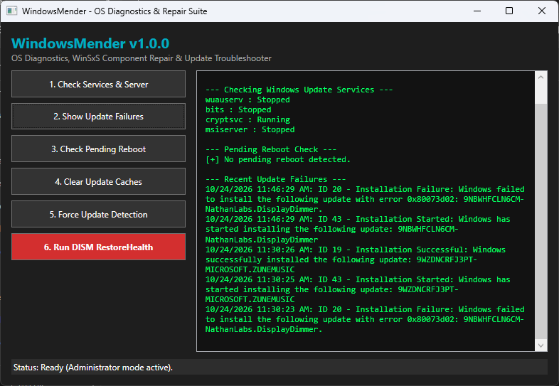

# WindowsMender v1.0.0

A modern, lightweight WPF desktop application designed for Windows OS diagnostics, WinSxS component store repair, and update troubleshooting.

## Features
- **Admin Elevation Check:** Automatic UI prompt to restart with administrator privileges when needed.
- **Service Diagnostics:** Inspects and controls core update services (`wuauserv`, `bits`, `cryptsvc`, `msiserver`).
- **Event Log Reader:** Scans for recent Windows Update failure entries.
- **Cache Cleaner:** Safely stops services and clears corrupted `SoftwareDistribution` and `Catroot2` caches.
- **Component Store Repair:** Executes DISM `RestoreHealth` with clear progress feedback and speed/corruption guidance.
- **Dark Mode UI:** Clean, responsive WPF user interface with text-wrapped logging and interactive tooltips.

## System Requirements
- **OS:** Windows 10 or Windows 11 (64-bit) / Windows Server 2016 or newer.
- **Privileges:** Administrator access is required to manage system services and run DISM component store repairs.
- **Runtime:** Self-contained executable (.NET 10 runtime bundled).

## License
Distributed under the MIT License. See `LICENSE` for details.